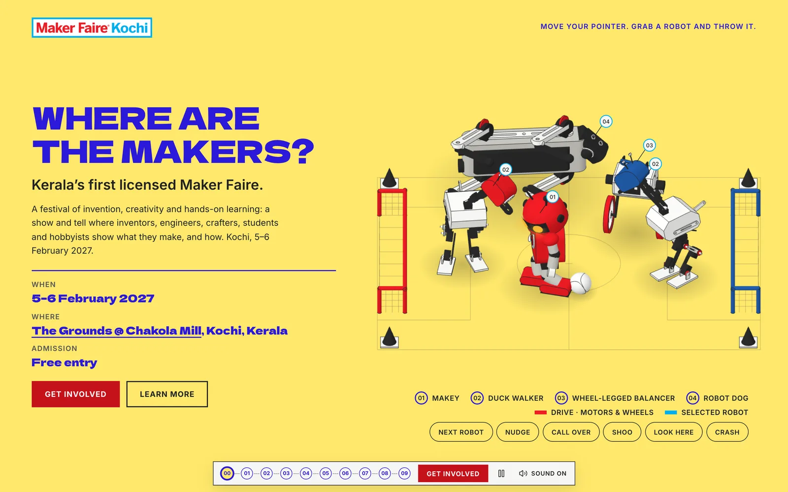

<p align="center">
  <a href="https://makerfaire.in/">
    
  </a>
</p>

<h1 align="center">Maker Faire Kochi 2027</h1>

<p align="center">
  <strong>Where are the makers?</strong><br>
  Kerala’s first Maker Faire · 5–6 February 2027 · The Grounds @ Chakola Mill, Kochi · Free entry
</p>

<p align="center">
  <a href="https://github.com/Maker-Faire-Kochi/Website/commits/main"></a>
  <a href="https://makerfaire.in/"></a>
  
  
</p>

<p align="center">
  <a href="https://makerfaire.in/"></a>
</p>

This is the source of **[makerfaire.in](https://makerfaire.in/)**, the public website for Maker Faire
Kochi 2027: a festival of invention, creativity and hands-on learning, where inventors, engineers,
crafters, students and hobbyists show what they make, and how.

Maker Faire Kochi is built collectively by **TinkerHub Foundation**, **MakerGram** and **Kerala
Startup Mission**, giving Kerala’s Fab Labs, tinkering labs, campuses and maker communities a shared
public stage.

## The event

| | |
|---|---|
| **When** | 5–6 February 2027, gates 9:00 AM IST |
| **Where** | [The Grounds @ Chakola Mill, Kochi, Kerala](https://maps.app.goo.gl/2oxa6AnE5HrnsaJ17) |
| **Admission** | Free entry |
| **Take part** | [makerfaire.in/interestform](https://makerfaire.in/interestform) (makers, workshops, exhibits) |
| **Volunteer** | [makerfaire.in/volunteer](https://makerfaire.in/volunteer) |
| **Contact** | [makerfairekochi@gmail.com](mailto:makerfairekochi@gmail.com) · [Instagram @makerfairekochi](https://instagram.com/makerfairekochi) |

## What’s on the site

A single scrolling page told in chapters, each with a **live, interactive three.js drawing**:

- **Hero:** a diorama of robots (Makey, two duck walkers, a wheel-legged balancer and a robot dog)
  playing football. Tap to call them over, or grab one and throw it.
- **What is Maker Faire:** the global network, from the Bay Area in 2006 to 200+ licensed faires in
  40+ countries.
- **Why Kochi:** a cheena vala worked by two fishers on the Fort Kochi backwater, “the world’s
  longest-running open hardware project”.
- **Where are the makers:** fourteen domains, from Robotics & AI and Electronics to Textiles, Pottery,
  Boats, Nets & Rope, and Cooking & Fermenting.
- **Workshop and Bench:** a carpenter building a stool, and a maker soldering at an electronics bench.
- **Make some noise:** a playable noise machine that drives a pen plotter.
- **When:** a split-flap countdown driven by a gear train.

Every drawing has a static poster fallback for reduced motion, Save-Data and browsers without WebGL,
plus keyboard equivalents for every pointer interaction.

Other routes: `/interestform` (interest form, stored in Supabase), `/volunteer` (media-team call) and
`/admin` (owner-only dashboard for responses).

## Tech stack

- [Nuxt 4](https://nuxt.com/) / Vue 3, server-rendered
- [three.js](https://threejs.org/) 0.186: one shared WebGL renderer, scenes in `app/three/`
- Tailwind CSS 4, Dela Gothic One + Inter + Noto Sans Malayalam
- [Supabase](https://supabase.com/) for interest responses and admin auth
- Deployed on **Cloudflare Workers** (Workers Builds on every push to `main`)

## Getting started

```bash
npm install
npm run dev          # http://localhost:3000
```

Copy the variables in [`supabase/README.md`](supabase/README.md) into a `.env` to enable the forms
and admin. The homepage runs without them.

### Production build

```bash
npm run build
node .output/server/index.mjs     # or: npm run preview
```

### Checks

There is no test runner; checks are scripts:

```bash
npm run test:three        # robot balance, gait, collisions and every scene
npm run test:contrast     # WCAG contrast for every colour pair the site paints
npm run test:interest     # interest form validation
npm run check:overflow    # (dev server running) no text overflows, 320–3840px wide
npm run posters           # (dev server running) regenerate scene posters in public/img/scenes
```

In development, `/lab/<scene>` shows a single scene on its own.

## Project layout

```
app/
  pages/          index, interestform, volunteer, admin/, lab/
  components/     page sections (home/), three.js slots and chapters (three/)
  three/          scenes, people, robots, and the shared stage/clock
  modules/        interest form and admin dashboard
server/api/       interest, volunteer and admin endpoints
shared/           validation shared by client and server
supabase/         migrations and setup notes
scripts/          tests, screenshots, poster renderer
```

Design and engineering notes for contributors live in [`CLAUDE.md`](CLAUDE.md) and
[`PRODUCT.md`](PRODUCT.md).

## Trademark

Maker Faire is a registered trademark of Make Community LLC. Maker Faire Kochi is independently
organized and operated under license from Make Community LLC.
